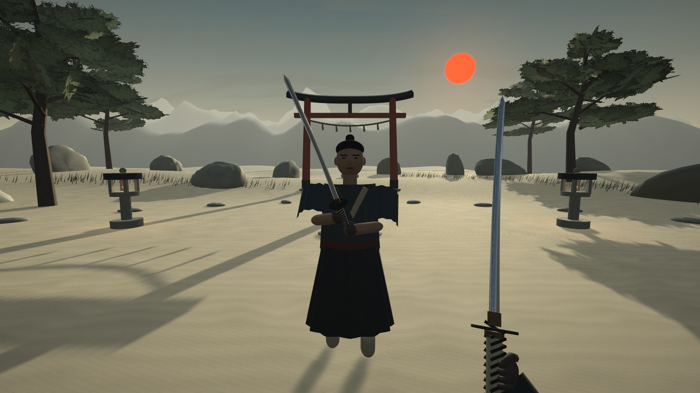

# Ganryujima: Bounce Back — Unity

**Unity 6.3 LTS (6000.3.10f1), C#, built-in renderer. Milestones 1–3 and the requested environment art pass are complete.** A first-person duel against Arima Kihei with a procedural arena, katana, stamina, directional defense, and keyboard face mock. The original web prototype is archived in work/web-prototype. AGENTS.md contains the full brief and Unity engine override.

## Open and play

1. Clone the repository (or pull the latest main branch if you already have it).
2. Unity Hub → Add project from disk → select the root folder containing Assets, Packages, and ProjectSettings. Use 6000.3.10f1.
3. Open Assets/Scenes/PracticeGround.unity and press Play. Click Game view, then **Enter the court**.
4. Arima will approach and circle. Match the incoming zone with 1–4 and press RMB as the tell fills. After a parry, release RMB and strike during **COUNTER NOW**. Use Space or WASD to leave his reach.

If the scene is missing, choose **Ganryujima → Create practice scene**. The scene generates geometry at runtime; no downloaded art, webcam, face model, or extra package is required.

## Combat controls

| Input | Action |
| --- | --- |
| WASD | Footwork / strafing, with collision and court boundary |
| Mouse | Look and select stance with a directional flick |
| Mouse up / down / left / right | Upper / Lower / Middle / Side stance |
| 1 / 2 / 3 / 4 | Upper / Middle / Lower / Side fallback |
| LMB press and release | Light strike |
| Hold LMB for 0.55 s, release | Heavy strike; requires more stamina |
| RMB press | Begin directional guard; first 0.18 s is the parry window |
| Hold RMB | Block matching-zone strikes, consuming stamina |
| Space | Short backward retreat, stamina cost and cooldown; no i-frames |
| F2 | Toggle field notes: controls and face-input debug values |
| F1 | Dev A camera/face diagnostics |
| Esc | Freeze the duel and release the cursor |
| R | Reset both duelists, stamina, AI, and positions; re-enter duel |

Strikes resolve once after wind-up, using distance and a forward aim cone. Missing still costs stamina. Heavy strikes have more damage, reach, and recovery time. Guard/charge/attack states slow movement. Guarding continuously drains stamina; a late matching guard blocks at additional cost. A wrong zone or an attack from behind hits health. Exhausting guard breaks it and briefly prevents attacks/guard. Releasing guard has a short rearm delay, so repeated clicks cannot keep a permanent parry window. Stamina regenerates after a delay while resting.

## Arima duel (milestone 3)

Arima moves through Idle → Circle → Windup → Strike → Recover → Guard. He approaches to sword distance, alternates circling direction, and commits his facing during a cut. Leaving range or moving behind that committed cut avoids damage. First attacks cycle Upper → Middle → Lower; every fourth attack withdraws into a feint and changes zones with a fresh full tell. Feints share the initial tell with real cuts; gaze-assisted detection is milestone 4.

A matching timed parry sends Arima into **Recoil → Counter**. The HUD announces the 1.05-second counter window; a hit landing during it deals 1.5× damage and staggers him. Heavy hits interrupt his attack. Light hits do not continuously stun-lock him. During Guard, he blocks light cuts in his displayed zone; change zone or use a heavy cut. All tuning lives in GameConfig.cs.

The duel ends when either health bar reaches zero: Arima yields on victory; defeat offers another attempt. **R** resets both fighters. Story consequences, wounds and persistent bounce-back stats remain later milestones. The old PracticeExchange fixture stays available for regression checks but no longer runs in the game.

Pausing or losing focus cancels held charge/guard, freezes combat and AI together, and keeps face.tick() running. Hit-stop uses a local gameplay clock; Unity's global Time.timeScale remains unchanged. Effects use a fixed pool of 16 spark meshes. Arima has a procedural clothed model and sword poses, not a finished realistic character or motion-captured animation.

## Face mock (readout only)

| Input | Mock value |
| --- | --- |
| Q / E | Lean left/right plus one-frame leanTrigger |
| F | Kiai pulse |
| Y / N | Nod/shake pulse |
| Hold C | Low composure; otherwise high |
| Z / X / V | Gaze left/center/right |
| G | Toggle left wink |

Face-driven dodges, kiai, composure changes to parry/time, and gaze tells are intentionally not wired until milestone 4. The current parry window is a fixed game-config value.

## Code and ownership

- Assets/Scripts/Core/GameLoop.cs: bootstrap, frame loop, keyboard/mouse input, movement, cursor capture, reset.
- Assets/Scripts/Core/GameConfig.cs: game thresholds, costs, damage, ranges, cooldowns, windows, and DEBUG_INPUT.
- Assets/Scripts/Combat/CombatModel.cs: deterministic stamina/health/strike/guard/parry rules; no input or rendering dependency.
- Assets/Scripts/Combat/PracticeExchange.cs: retained milestone-2 test fixture.
- Assets/Scripts/Combat/ArimaOpponent.cs: deterministic opponent FSM, footwork, defense and counter windows.
- Assets/Scripts/World/ArimaArt.cs: generated duelist and articulated sword/arm poses.
- Assets/Scripts/Combat/CombatPresentation.cs: procedural sword poses, local hit-stop, shake, recoil, pooled sparks.
- Assets/Scripts/UI/CombatHud.cs: health/stamina, maai, stance/charge, tell, face readout, entry/reset prompts.
- Assets/Scripts/World/ArenaBuilder.cs: procedural court and scenery.
- Assets/Scripts/Input/Face: Dev A's shared C# contract and mock, integrated from their parallel commit; no Dev B gameplay changes in this folder.
- Assets/Editor: scene generation, deterministic regression checks, and Play Mode smoke check.

Gameplay consumes only IFaceInput through FaceInputFactory.createFaceInput(), calling tick() first each frame then getState(). FaceState is a value snapshot with the original field names/ranges, enums for gaze/wink, Task async methods, and millisecond timestamps. Dev A's shared C# contract and real local MediaPipe bridge are integrated. With DEBUG_INPUT enabled, the factory returns MockFaceInput. Dev A also provides a session-only camera override, calibration, and fallback. See [Dev A's setup guide](Assets/Scripts/Input/Face/README.md) before enabling the camera. Dev B has not modified their implementation or wired face values into combat.

Input uses Unity's built-in legacy Input Manager. Resources material templates retain shader references in builds. Close Play Mode before pulling changes from GitHub.

## Verification

Unity 6000.3.10f1 compiled milestone 3 and passed **38 combat and 33 opponent assertions**, covering single-hit resolution, aim/range misses, heavy costs, action locks, regeneration, timing/zone/facing guard rules, breaks/rearm, retreat cost/cooldown, pause, practice rhythm, defeat, and retry. Run **Ganryujima → Check combat rules** and **Ganryujima → Check Arima rules** to repeat these checks. Opponent checks cover approach, pause, committed-cut evasion, parry/recoil/counter damage and expiry, guard, heavy stagger, feints, defeat, yield, retry and cleanup. The batch method Ganryujima.Editor.ProjectSetup.Smoke runs those checks and enters Play Mode, verifying combat/camera/controller initialization and ten face-loop frames.

Validation ran in an isolated project copy so it did not close the working editor or replace its scene. The environment art pass was rendered through the real Unity Direct3D 11 camera at 1600×900 and visually inspected. The live menu/HUD was compiled, but interaction in the already-running editor session was not completed. Interactive movement and performance have not been benchmarked. Unity's internal editor SearchDatabase startup code emitted an indexing exception; no gameplay-code exceptions were observed.

## Environment art pass

The user requested this art pass before opponent AI. The court now uses sculpted dunes, irregular granite, procedural pine needle textures, clustered coastal grasses, a sea inlet, a curved weathered torii with hemp bindings, stone lanterns, and a bound-straw practice post. The katana has a curved diamond-section blade, temper line, brass fittings, silk wrap, and wrapped hands/sleeves. Lower weapon framing leaves the target visible.

Lighting uses a warm low sun, cool sky fill, real-time soft shadows, atmospheric mountain layers, and a custom dawn sky. A lightweight Built-in Render Pipeline image effect adds restrained grain, vignette, desaturation, and glow. The HUD is slimmer; gameplay field notes live behind F2; F1 is reserved for Dev A's camera diagnostics. Visual tuning lives in Assets/Scripts/Core/VisualConfig.cs.

All meshes and textures are generated locally in C#. No new downloaded art or third-party packages are used; Unity's built-in image-conversion module is enabled for editor screenshot export. Generated native assets are owned and released with their scene objects. Custom shaders are under Assets/Resources/Shaders so they remain referenced in player builds. This is a procedural, stylized environment pass; finished character art/animation, authored cinematics, and audio remain future work.

**After pulling changes, stop Play and restart it.** Runtime-generated scenery does not rebuild in an existing Play session. If scripts reload while playing, the game displays a restart notice instead of running with lost interface/model instances.

The editor method Ganryujima.Editor.VisualCapture.Run runs combat checks and saves actual camera renders after entering Play Mode. It accepts an optional GANRYUJIMA_CAPTURE_DIR environment variable. Camera renders exclude the HUD. The original 38 combat checks continue to pass, with no changes to Dev A's face-input files.
## Next milestone

Milestone 3: Arima's opponent FSM, zone attacks, wind-up tells, feints, recoil/stagger, and parry → recoil → counter window. Continue one milestone per request.

## Theme and credits

The core theme is parry → bounce back → counter. Future duel losses cause wounds healed by composure meditation. Unity supplies the engine; all geometry is procedural. Future narrative adapts legend-adjacent Musashi accounts rather than claiming historical reconstruction; document specific historical sources as story content is added.
