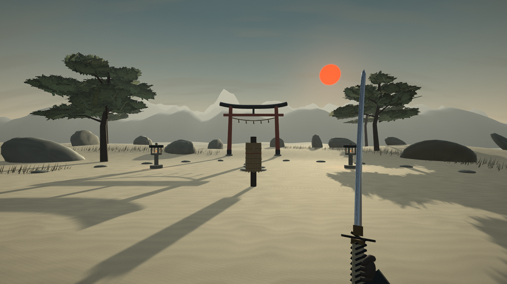

# Ganryujima: Bounce Back — Unity

**Unity 6.3 LTS (6000.3.10f1), C#, built-in renderer. Milestones 1–4 and the requested environment art pass are complete.** A first-person duel against Arima Kihei with a procedural arena, katana, stamina, directional defense, and keyboard face mock. The original web prototype is archived in work/web-prototype. AGENTS.md contains the full brief and Unity engine override.

## Open and play

1. Clone the repository (or pull the latest main branch if you already have it).
2. Unity Hub → Add project from disk → select the root folder containing Assets, Packages, and ProjectSettings. Use 6000.3.10f1.
3. Open Assets/Scenes/PracticeGround.unity and press Play. Click Game view, then **Enter the court**.
4. Arima will approach and circle. Match the incoming zone with 1–4 and press RMB as the tell fills. After a parry, release RMB and strike during **COUNTER NOW**. Use Space or WASD to leave his reach.

If the scene is missing, choose **Ganryujima → Create practice scene**. The scene generates geometry at runtime; the samurai model and textures are included in the repository; no asset-site account, webcam, or separate face model is required.

## Combat controls

| Input | Action |
| --- | --- |
| WASD | Footwork / strafing, with collision and court boundary |
| Mouse | Look and select stance with a directional flick |
| Mouse up / down / left / right | Upper / Lower / Middle / Side stance |
| 1 / 2 / 3 / 4 | Upper / Middle / Lower / Side fallback |
| LMB press and release | Light strike |
| Hold LMB for 0.55 s, release | Heavy strike; requires more stamina |
| RMB press | Begin directional guard; composure sets the initial 0.10–0.26 s parry window (neutral 0.18 s) |
| Hold RMB | Block matching-zone strikes, consuming stamina |
| Space | Short backward retreat, stamina cost and cooldown; no i-frames |
| F2 | Toggle field notes: controls and face-input debug values |
| F1 | Dev A camera/face diagnostics |
| Esc | Freeze the duel and release the cursor |
| R | Reset both duelists, stamina, AI, and positions; re-enter duel |

Strikes resolve once after wind-up, using distance and a forward aim cone. Missing still costs stamina. Heavy strikes have more damage, reach, and recovery time. Guard/charge/attack states slow movement. Guarding continuously drains stamina; a late matching guard blocks at additional cost. A wrong zone or an attack from behind hits health. Exhausting guard breaks it and briefly prevents attacks/guard. Releasing guard has a short rearm delay, so repeated clicks cannot keep a permanent parry window. Stamina regenerates after a delay while resting.

## Arima duel (milestone 3)

Arima moves through Idle → Circle → Windup → Strike → Recover → Guard. He approaches to sword distance, alternates circling direction, and commits his facing during a cut. Leaving range or moving behind that committed cut avoids damage. First attacks cycle Upper → Middle → Lower; every fourth attack withdraws into a feint and changes zones with a fresh full tell. Feints share the initial tell with real cuts; centered gaze can reveal the feint before withdrawal.

A matching timed parry sends Arima into **Recoil → Counter**. The HUD announces the 1.05-second counter window; a hit landing during it deals 1.5× damage and staggers him. Heavy hits interrupt his attack. Light hits do not continuously stun-lock him. During Guard, he blocks light cuts in his displayed zone; change zone or use a heavy cut. All tuning lives in GameConfig.cs.

The duel ends when either health bar reaches zero: Arima yields on victory; defeat offers another attempt. **R** resets both fighters. Story consequences, wounds and persistent bounce-back stats remain later milestones. The old PracticeExchange fixture stays available for regression checks but no longer runs in the game.

Pausing or losing focus cancels held charge/guard, freezes combat and AI together, and keeps face.tick() running. Hit-stop uses a local gameplay clock; Unity's global Time.timeScale remains unchanged. Effects use a fixed pool of 16 spark meshes. Arima now uses a downloaded textured, skinned samurai with its walk animation and procedural combat poses. Combat animations are not motion-captured.

## Face gameplay (milestone 4)

The mock provider stays enabled by default, so all abilities work without a webcam. With Dev A's real provider enabled and calibrated, the same IFaceInput fields drive the same rules.

| Gesture / mock key | Gameplay |
| --- | --- |
| Lean left/right / Q or E | Lateral dodge: 0.28 s movement, first 0.18 s invulnerable, 0.85 s cooldown, 14 stamina |
| Kiai / F | Stagger Arima within 3.8 m and a 65° facing cone; 1.1 s stagger, 8 s cooldown, 18 stamina; shockwave and shake |
| Calm face / release C | Wider parry window, up to 0.26 s; calm clashes briefly slow the local gameplay clock |
| Agitated face / hold C | Narrower parry window, down to 0.10 s; restrained edge blur/darkening |
| Center gaze / X | Focus on Arima for 0.15 s within 5 m / 20° to reveal committed cuts versus feints |
| Look aside / Z or V | Remove gaze assistance; ordinary zone tells still work |
| Y / N / G | Nod / shake / wink debug values, reserved for later story work |

Release Q/E back to neutral before repeating a lean in the same direction. Space remains a backward footwork retreat with **no i-frames**. Dodge cancels guard/charging, but cannot cancel a committed swing or guard break. Kiai cannot overlap a swing/dodge/charge; a successful shout spends its cost/cooldown even if the opponent is out of range. It does no damage and preserves an existing parry-counter opening. Cooldowns use gameplay seconds, including clash slow motion.

Parry width is captured when RMB is pressed, so changing composure never reopens an old guard. High composure produces a short slowdown only on clashes (parry, player block, enemy block), reaching ×0.72 at full composure. Face sampling, camera lean smoothing, and effect lifetimes use the unscaled clock; Unity's global timeScale stays 1. The player and opponent share the same slowed combat clock.

Lost or uncalibrated tracking rejects gesture pulses, recenters camera lean, and uses neutral 0.18 s parries. Dev A's provider may instead supply its keyboard fallback, which is accepted through the same interface. Unknown or off-center gaze simply hides the extra hint. Paused gestures are discarded. One-frame gestures during hit-stop are buffered for at most 0.18 s and consumed once; cooldown input is not queued. Retry clears all ability state.

The compact lower-right HUD shows effective composure/parry width, ability cooldowns, gaze focus and local time scale. **F2** adds raw face fields, i-frame time and buffered-input state; **F1** remains Dev A's diagnostics. Real-camera setup is in [Dev A's guide](Assets/Scripts/Input/Face/README.md).

## Code and ownership

- Assets/Scripts/Core/GameLoop.cs: bootstrap, frame loop, keyboard/mouse input, movement, cursor capture, reset.
- Assets/Scripts/Core/GameConfig.cs: game thresholds, costs, damage, ranges, cooldowns, windows, and DEBUG_INPUT.
- Assets/Scripts/Combat/CombatModel.cs: deterministic stamina/health/strike/guard/parry rules; no input or rendering dependency.
- Assets/Scripts/Combat/PracticeExchange.cs: retained milestone-2 test fixture.
- Assets/Scripts/Combat/ArimaOpponent.cs: deterministic opponent FSM, footwork, defense and counter windows.
- Assets/Scripts/World/ArimaArt.cs: imported character wrapper; SamuraiRig.cs samples walk animation and poses the sword, arms, fingers and feet.
- Assets/Scripts/Combat/FaceGameplay.cs: consumes snapshots, buffers hit-stop gestures, handles gaze focus and local clash time.
- Assets/Scripts/Combat/CombatPresentation.cs: procedural sword poses, local hit-stop, shake, recoil, pooled sparks.
- Assets/Scripts/UI/CombatHud.cs: health/stamina, maai, stance/charge, tell, face readout, entry/reset prompts.
- Assets/Scripts/World/ArenaBuilder.cs: procedural court and scenery.
- Assets/Scripts/Input/Face: Dev A's shared C# contract and mock, integrated from their parallel commit; no Dev B gameplay changes in this folder.
- Assets/Editor: scene generation, deterministic regression checks, and Play Mode smoke check.

Gameplay consumes only IFaceInput through FaceInputFactory.createFaceInput(), calling tick() first each frame then getState(). FaceState is a value snapshot with the original field names/ranges, enums for gaze/wink, Task async methods, and millisecond timestamps. Dev A's shared C# contract and real local MediaPipe bridge are integrated. With DEBUG_INPUT enabled, the factory returns MockFaceInput. Dev A also provides a session-only camera override, calibration, and fallback. See [Dev A's setup guide](Assets/Scripts/Input/Face/README.md) before enabling the camera. Dev B has not modified their implementation; FaceGameplay consumes its snapshots to control combat.

Input uses Unity's built-in legacy Input Manager. Resources material templates retain shader references in builds. Close Play Mode before pulling changes from GitHub.

## Verification

Unity 6000.3.10f1 compiled milestone 4 and passed **38 combat, 33 opponent and 46 face-gameplay assertions**, covering single-hit resolution, aim/range misses, heavy costs, action locks, regeneration, timing/zone/facing guard rules, breaks/rearm, retreat cost/cooldown, pause, practice rhythm, defeat, and retry. Run **Ganryujima → Check combat rules** and **Ganryujima → Check Arima rules** plus **Ganryujima → Check face gameplay** to repeat these checks. Face checks cover i-frames, stamina/cooldowns, guard-window snapshots, local time, pause, missing/invalid signals, one-frame buffering, gaze and reset. Opponent checks cover approach, pause, committed-cut evasion, parry/recoil/counter damage and expiry, guard, heavy stagger, feints, defeat, yield, retry and cleanup. The batch method Ganryujima.Editor.ProjectSetup.Smoke runs those checks and enters Play Mode, verifying combat/camera/controller initialization and ten face-loop frames.

Validation ran in an isolated project copy so it did not close the working editor or replace its scene. The environment art pass was rendered through the real Unity Direct3D 11 camera at 1600×900 and visually inspected. The live menu/HUD was compiled, but interaction in the already-running editor session was not completed. Interactive movement and performance have not been benchmarked. Unity's internal editor SearchDatabase startup code emitted an indexing exception; no gameplay-code exceptions were observed.

## Environment art pass

The user requested this art pass before opponent AI. The court now uses sculpted dunes, irregular granite, procedural pine needle textures, clustered coastal grasses, a sea inlet, a curved weathered torii with hemp bindings, stone lanterns, and a bound-straw practice post. The katana has a curved diamond-section blade, temper line, brass fittings, silk wrap, and wrapped hands/sleeves. Lower weapon framing leaves the target visible.

Lighting uses a warm low sun, cool sky fill, real-time soft shadows, atmospheric mountain layers, and a custom dawn sky. A lightweight Built-in Render Pipeline image effect adds restrained grain, vignette, desaturation, and glow. The HUD is slimmer; gameplay field notes live behind F2; F1 is reserved for Dev A's camera diagnostics. Visual tuning lives in Assets/Scripts/Core/VisualConfig.cs.

Environment and player-weapon art are generated locally in C#. Arima uses the CC0 downloaded model described below. Unity's built-in animation and image-conversion modules support the character and editor screenshots; no third-party runtime packages are used. Generated native assets are owned and released with their scene objects. Custom shaders are under Assets/Resources/Shaders so they remain referenced in player builds. This is a procedural, stylized environment pass; finished character art/animation, authored cinematics, and audio remain future work.

**After pulling changes, stop Play and restart it.** Runtime-generated scenery does not rebuild in an existing Play session. If scripts reload while playing, the game displays a restart notice instead of running with lost interface/model instances.

The editor method Ganryujima.Editor.VisualCapture.Run runs combat checks and saves actual camera renders after entering Play Mode. It accepts an optional GANRYUJIMA_CAPTURE_DIR environment variable. Camera renders exclude the HUD. The original 38 combat checks continue to pass, with no changes to Dev A's face-input files.
## Next milestone

Milestone 5: JSON story state machine, choices, cutscenes, Honor/Fame/wounds and bounce-back tally. Continue one milestone per request.

Dev A is also building the **start/title screen** and will push it separately. Dev B owns the gameplay HUD and pause flow; preserve Dev A's start-screen work when integrating incoming commits.

For remaining content, use suitable licensed internet assets for characters, animations, environments, textures, effects, audio, and UI art. Preserve the realistic samurai / ink-wash direction and keep source, license, credit, and origin records alongside each import. The original procedural-only restriction is superseded by the user's direction.

## Theme and credits

The core theme is parry → bounce back → counter. Future duel losses cause wounds healed by composure meditation. Unity supplies the engine; the game combines procedural scenery with licensed imported assets. Future narrative adapts legend-adjacent Musashi accounts rather than claiming historical reconstruction; document specific historical sources as story content is added.

## Downloaded samurai character

Arima's primitive body has been replaced with [Grab3D's rigged Samurai](https://grab3d.com/models/characters/samurai/), released under CC0. The provider discloses AI-assisted Meshy generation, Blender cleanup, and automated rigging. The exact license, origin manifest, source URL and file hash live in Assets/Art/Samurai. This is an art representation, not a historically verified likeness of Arima.

The imported character has 295,015 triangles, 54 skin bones, and 2048px color/normal/metallic/roughness maps. We pack roughness into Unity's smoothness channel, normalize its height, sample the supplied walk animation, and drive combat arm/foot poses from the existing FSM. The prefab and all assets are committed; **stop Play before pulling, then press Play again**. The built-in animation module is now enabled.

Validation: 71 combat/AI checks, actual Unity camera renders of idle, walk, windup and parry-counter poses. The dense model is currently intended for this single-opponent scene; a 60 FPS target has not yet been benchmarked on the user's laptop. No face-input implementation was changed.

Milestone 4 validation uses synthetic contract snapshots plus the keyboard mock startup; live webcam gesture accuracy was not tested. The rendered integration check exercises actual CharacterController dodge movement, kiai stagger/shockwave, and the composure shader.

## Finishing-blow cutscene

Defeating Arima automatically plays a 3.8-second first-person sequence: letterbox, deliberate wind-up, camera push, finishing cut, impact flash/sparks and sword sound, followed by his kneeling defeat pose and the victory screen. It fires once per duel. Space skips; Esc pauses/resumes. Losing application focus pauses it. R restarts after the result, restoring both fighters and clearing the cinematic. Face input keeps ticking while cinematic gameplay actions are suppressed. Unity global timeScale stays unchanged.

The existing CC0 imported samurai is posed on its skeleton. This is a directed procedural animation, not a downloaded execution/mocap clip. The sword sound is SFXMint's CC0 “Sharp Sword Slash With Metal Ring 03”; source, license and AI/procedural origin disclosure are retained in Resources/Audio/Finisher. No added runtime network dependency.

Finisher checks cover victory-only activation, one-shot trigger, pause, single impact cue, natural completion, skip, retry and unchanged damage. The editor method Ganryujima.Editor.FinisherChecks.Capture exercises the actual imported rig, camera restore, sound import and continuing face ticks, and saves camera renders. Camera renders exclude the in-game letterbox/caption overlay.
